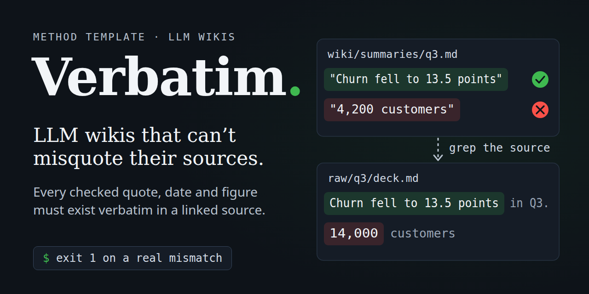

# Verbatim

**LLM wikis that can't misquote their sources.**



Verbatim turns a pile of documents (PDFs, slide decks, transcripts, articles) into a knowledge base that an LLM writes and maintains, then proves that every quote, date and figure in it really appears in your sources.

The knowledge base is an interlinked wiki: markdown pages for concepts, entities, source summaries and cross-source syntheses, all linking to each other. This is the llm-wiki pattern Andrej Karpathy described (see [Credits](#credits)). Verbatim adds the part that makes it trustworthy.

## What it does

1. **You design the schema.** `CLAUDE.md` defines your page types, tags, confidence levels and the outputs you want. The agent builds the structure you specified, not a generic one. ([Guide](docs/designing-your-schema.md))
2. **It extracts from your raw data.** PDFs and decks become greppable text in `raw/`. Claude Code reads each source and writes schema-conforming wiki pages that cite it.
3. **It checks the result.** Every quote, date and figure on a page must exist verbatim in the raw file that page links. A checker greps for each one and exits non-zero when one drifts.

Most LLM knowledge tools say they cite their sources. This one verifies the citation by code, so a model is not grading its own homework.

## See it fail

Say the source reads "We now serve 14,000 customers", and the wiki page written from it says "4,200 customers". The checker catches it:

```
$ python3 scripts/AdjudicateSuspects.py
REAL MISMATCH                                 wiki/summaries/quarterly-update.md
                                                "4,200"

total suspects adjudicated: 1
REAL MISMATCHES: 1
EVIDENCE ERRORS: 0
$ echo $?
1
```

Fix the page to say 14,000 and the same command prints `REAL MISMATCHES: 0` and `EVIDENCE ERRORS: 0`, and exits 0.

## Who it's for

Use it if you are turning a corpus (course material, research, vendor documents, transcripts) into a structured knowledge base with Claude Code, and the numbers and quotes have to be right. It is also a worked example of a schema you can adapt to your own domain.

It is not a note-taking app, and it does not judge whether a page's argument is sound. It checks literals: quotes, dates and figures. See [Limits](#limits).

## Quick start

You need [Claude Code](https://claude.ai/code) (or another Agent Skills-compatible tool), [Bun](https://bun.sh) and `pdftotext` (poppler-utils) for PDF extraction, and Python 3.10 or newer.

1. **Get the repo.** Clone it (or use it as a template), then `cd` into it.

2. **Design your schema.** Open `CLAUDE.md` and fill in the `CUSTOMIZE` sections: your domain, your raw-source streams, your tag taxonomy and your output products. See [Designing Your Schema](docs/designing-your-schema.md).

3. **Add sources.** For PDFs and decks:

   ```
   bun scripts/ExtractPdf.ts path/to/pdfs --topic my-stream
   ```

   The original PDF is kept next to its extracted `.md`. For text you already have, put markdown files in `raw/<topic>/` with the metadata header from `.claude/skills/karpathy-llm-wiki/references/raw-template.md`.

4. **Ingest, one source first.** In Claude Code:

   ```
   ingest raw/my-stream/2026-04-12-platform-strategy.md
   ```

   Review the pages it wrote, tune `CLAUDE.md`, then ingest the rest one at a time. Ingest is sequential because the index, the log and the concept pages are shared.

5. **Verify after every batch.**

   ```
   python3 scripts/AdjudicateSuspects.py
   ```

   Keep going until it prints `REAL MISMATCHES: 0` and `EVIDENCE ERRORS: 0` (exit status 0). If your PDFs leave repeating headers or footers in the text, add them to `FURNITURE_PATTERNS` at the top of that script.

Then ask the wiki questions in Claude Code. Answers cite pages, and durable answers can be saved as synthesis pages. Decks, plans and reports are built as synthesis pages first and exported to `presentations/` last.

## Reading the verifier's output

The underlying checker is deliberately strict, and text extracted from PDFs makes it raise false alarms (page headers, hyphenated line wraps). `AdjudicateSuspects.py` re-tests each suspect against cleaned-up raw text and sorts it:

- **FALSE-POSITIVE**: the quote is in the source once page furniture is stripped. Leave it alone.
- **REAL MISMATCH**: it is still not in the source. Fix the wiki page.
- **EVIDENCE ERROR**: a page has no `Raw` link, or the link does not resolve. Fix the link.

Never edit the extracted text in `raw/` to make a claim pass. That defeats the whole check.

## What's in the repo

```
CLAUDE.md                          your schema (customize this)
raw/                               your sources, immutable (starts empty)
wiki/                              the pages the agent writes (starts with index.md, log.md)
presentations/                     exports built from synthesis pages (starts empty)
scripts/ExtractPdf.ts              PDF to greppable markdown
scripts/AdjudicateSuspects.py      the verification gate
.claude/skills/karpathy-llm-wiki/  the vendored engine: ingest, query, lint, check_evidence.py
docs/                              guides and reference
assets/                            the social preview card
```

## Limits

Verification covers literals, not reasoning, and only some literals in some places. In short:

- Slide decks extract sparsely. Claims that rest on a chart cap the page at `confidence: medium` or lower.
- Quotes, ISO dates and figures are checked. Whether the argument is sound is a human judgment.
- Image-only PDFs are rejected, not guessed at. Run OCR first.
- A figure attached to letters, such as `2.5mg` or `$10bn`, can be wrong and still pass.

The full list is in [Where The Invariant Doesn't Reach](docs/limits.md). Read it before you rely on the gate.

## Check your install

```
python3 scripts/run_tests.py
python3 scripts/test_adjudicate.py
bun test scripts/
python3 scripts/AdjudicateSuspects.py
```

On the empty skeleton the last command prints `REAL MISMATCHES: 0` and exits 0. Without `pdftotext`, `bun test` prints a SKIPPED warning and still exits 0. That is not a pass, so install poppler-utils first. macOS ships an older `python3`, so install a current one.

## Go deeper

- [Designing Your Schema](docs/designing-your-schema.md)
- [How LLMs Actually Break Quotes](docs/how-llms-break-quotes.md): the failure modes seen in production
- [Why This Exists](docs/why-this-exists.md)
- [Operational Lessons](docs/operational-lessons.md)
- [Where The Invariant Doesn't Reach](docs/limits.md)

## Credits

Verbatim is a derivative work and says so. [ATTRIBUTION.md](./ATTRIBUTION.md) has full credit and license texts.

- **Andrej Karpathy**: the llm-wiki pattern, with three layers and three operations.
- **[Astro-Han/karpathy-llm-wiki](https://github.com/Astro-Han/karpathy-llm-wiki)** (MIT): the operations engine and the grounding invariant itself, vendored unmodified.
- **[tonbistudio/llm-wiki](https://github.com/tonbistudio/llm-wiki)** (MIT): the page-type taxonomy.

Added here: the adjudication layer, the PDF corpus pipeline, the quote-failure taxonomy, and the stated limits.
